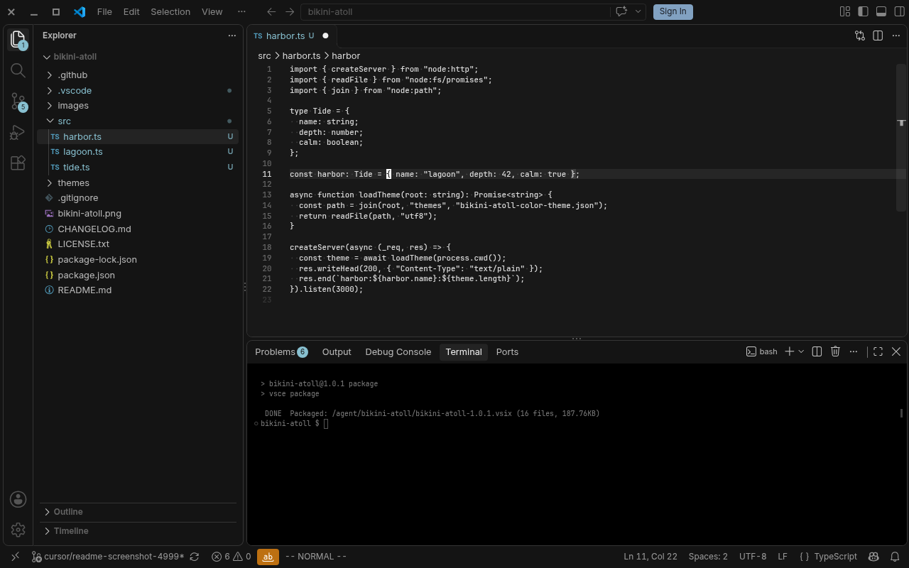

# Bikini Atoll for VS Code

A dark theme with no syntax highlighting, for focused coding sessions.

## Themes

- **Bikini Atoll** is a dark theme based on Cursor Dark.

## Features

- Dark theme with no syntax highlighting.
- Ideal for focused coding sessions.

## License

MIT
